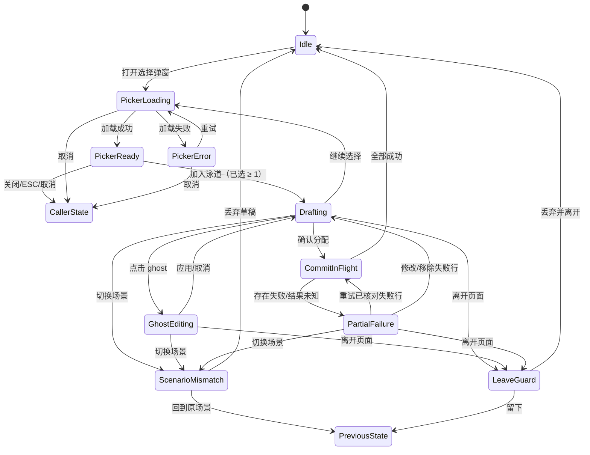

# 人员分配工作台方案 v2

- 日期：2026-11-13
- 状态：Codex 修订版已通过 Claude 复评（PASS）
- 作者：Claude / GLM 联合评审后修订
- 关联文档：
  - `docs/plans/2026-11-13-person-assignment-editor-design.md`
  - `docs/plans/2026-10-14-capacinator-improvement-plan.md`
- 适用范围：人员工作负载页、任务选择、草稿分配、容量泳道

---

## 1. 背景与问题

当前“添加分配”交互是：

```text
人员页
  → 左侧任务树/任务托盘
  → 搜索/浏览任务
  → 下方表单填写角色/比例/日期
  → 提交
```

主要问题：

1. 任务树常驻，挤占人员上下文。
2. 任务托盘只展示任务名，缺少状态、角色需求、人力、已分配等真实上下文。
3. 添加表单与容量后果分离，用户提交后才知道超载。
4. 一次只能添加一条，批量补任务效率低。
5. “排工作”的感觉弱，更像录数据。

---

## 2. 目标与非目标

### 2.1 目标

1. 人员上下文常驻：默认页面以人员容量和泳道为主。
2. 任务界面按需弹出：需要时打开真实任务界面，不常驻。
3. 支持多选任务。
4. 选择与提交分离：先变成泳道 ghost，确认后才写库。
5. 容量后果实时可见：弹窗内显示迷你容量热区，泳道显示完整后果。
6. 容量只提醒，不阻断。
7. 保留数据完整性硬校验：重复键、SE/MDE 槽位、版本、场景归属。
8. 第一版先跑通最小闭环，不追求完整甘特编辑。

### 2.2 非目标

- 轻/重任务分类
- 自动推荐删除
- 容量阻断
- 常驻任务树/托盘
- 全页原子批量保存
- 自动排产
- 第一版拖拽
- 第一版撤销
- 第一版服务端批量接口

---

## 3. 核心决策

| 决策点 | 结论 |
|---|---|
| 默认页面 | 人员容量 + 工作负载泳道 + 当前分配明细 |
| 任务界面 | 不常驻，按需弹窗 |
| 弹窗形态 | 顶部对齐的居中大弹窗 |
| 任务选择 | 真实任务数据 + 真实层级 + 真实筛选，选择模式裁剪列 |
| 多选 | 支持，多选默认只处理 CREATE |
| 已有分配 | 单独进入 EDIT，不混入批量 |
| SE/MDE 替换 | 单独进入 REPLACE，必须显式确认 |
| 泳道 | 默认完整可见；弹窗内显示迷你容量热区 |
| ghost | 选中任务后先进入泳道，不立即写库 |
| 提交 | 显式“确认分配”，逐条提交 |
| 容量 | 只提醒，不阻断 |
| 场景 | 草稿绑定打开时的场景，切场景禁用提交 |
| 第一版拖拽 | 不做 |
| 第一版撤销 | 不做 |
| 第一版批量接口 | 不做，逐条调用现有 create/update |

---

## 4. 总体交互流程

```text
1. 用户在人员工作负载页
2. 点 [添加分配]
3. 打开顶部大弹窗，展示真实任务界面
4. 搜索/筛选/勾选多个任务
5. 弹窗顶部迷你容量热区实时显示当前 → 预计
6. 点 [加入泳道]
7. 弹窗关闭，选中任务变成泳道 ghost
8. 用户点击 ghost，打开参数面板调整角色/比例/日期
9. 点 [确认分配]
10. 逐条提交；成功行变实心，失败行保留 ghost + 错误
```

---

## 5. 默认页面：人员工作负载页

### 5.1 页面结构

```text
┌──────────────────────────────────────────────────────────────┐
│ ← 返回人员详情   陈主管   场景：基线    [添加分配]            │
├──────────────────────────────────────────────────────────────┤
│ 当前 129%   可用 100%   相对 129%   剩余 -29%   不计入 95%   │
│ ⚠ 已超出容量；仍可继续调整，容量只提醒不阻断保存              │
├──────────────────────────────────────────────────────────────┤
│ 工作负载泳道                                                  │
│                                                              │
│ 容量  ▂▃▅▇█▇▅▃  超载区间红色                                  │
│ 100% ────────────────────────────────────────────────        │
│                                                              │
│ 分析-报表-移动端   ███████████ 40%                            │
│ 数据脱敏                █████████ 50%                         │
│ 项目事务                  █████ 25%                           │
│ 开放API                   ░░░░░ 20%  ← ghost 待提交           │
│ 实时大屏                   ░░░░ 20%  ← ghost 待提交           │
│                                                              │
├──────────────────────────────────────────────────────────────┤
│ 待提交 2 条 | [继续选择] [确认分配] [清空]                    │
├──────────────────────────────────────────────────────────────┤
│ 当前分配明细（可折叠）                                        │
│ 项目 / 角色 / 阶段 / 来源 / 日期 / 比例 / 状态 / 操作         │
└──────────────────────────────────────────────────────────────┘
```

### 5.2 组成部分

#### A. 顶部容量区

展示：

- 当前分配
- 可用容量
- 相对利用率
- 剩余容量
- 不计入当前的分配
- 超载提示
- 参考日 `as_of`

规则：

- 可用率缺失显示“数据不可用”，不伪造 100%。
- 可用率 0 显示“无可用容量”，相对利用率显示“—”。
- 超载只提示，不阻止任何操作。

#### B. 工作负载泳道

泳道分两层：

1. **容量热区**
   - 按周/月显示总分配
   - 100% 容量线
   - 超过 100% 的区间红色底纹
   - 显示当前与 ghost 合并后的预计曲线

2. **分配 bar 层**
   - 一行一个项目，项目下可有多条分配
   - bar 长度 = 起止日期
   - bar 标签 = 项目 + 角色 + 比例
   - fixed 实心
   - phase/project 派生日期虚线 + 锁
   - paused 灰色
   - future/ended 淡化
   - ghost 斜纹/半透明

#### C. 待提交操作条

有 ghost 时显示：

```text
待提交 2 条 | [继续选择] [确认分配] [清空]
```

无 ghost 时隐藏。

#### D. 当前分配明细表

保留现有能力：

- 行级编辑
- 暂停/恢复
- 删除
- 交接

第一版泳道上的已有 bar 不直接编辑，点击 bar 只定位到明细表对应行。

---

## 6. 任务选择弹窗

### 6.1 弹窗形态

- 桌面：顶部对齐的居中大弹窗
- 宽度：`min(1280px, 92vw)`
- 高度：`80–85vh`
- 顶部距离：`24–40px`
- 背景遮罩
- 内部独立滚动
- ESC / 关闭按钮可退出

矮屏不降级为底部弹层：仍保持顶部对齐，顶部距离收窄到 `12–16px`，高度上限 `92vh`，任务表在弹窗内部滚动。窄屏第一版不作为验收目标，可横向滚动。

### 6.2 弹窗结构

```text
┌──────────────────────────────────────────────────────────────┐
│ 为 陈主管 选择任务     已选 3       [关闭]                    │
│ 当前 129% → 预计 169% | 超载 69%                             │
│ 迷你容量热区：1月 ▂▃▅▇█▇▅ 2月 ...（选中任务实时进入）         │
├──────────────────────────────────────────────────────────────┤
│ [搜索项目/任务] [筛选] [任务范围：需求交付 ▾]                 │
│                                                              │
│ ☑ 项目/任务           状态     角色需求   日期    人力  已分配 │
│ ☑ 分析-平台-开放API   进行中   SE 缺口1  3-4月   0/1   0      │
│ ☑ 分析-报表-实时大屏  未开始   MDE 缺口1 5-6月   0/1   0      │
│ ☐ 分析-报表-建模工作台 进行中  SE        1-6月   1/1   1      │
│   └ 公式引擎          进行中   SE        3-4月   已分配       │
├──────────────────────────────────────────────────────────────┤
│ 已选 3：开放API、实时大屏、建模工作台                         │
│ 统一角色 [SE ▾] 比例 [20%] 日期模式 [固定 ▾] [起] [止]       │
│ 影响预览：129% → 169%  超出 69%                              │
│ [加入泳道] [取消]                                            │
└──────────────────────────────────────────────────────────────┘
```

### 6.3 任务界面要求

“真实任务界面”指：

- 真实项目/任务层级
- 真实状态
- 真实角色需求
- 真实日期
- 真实人力/已分配情况
- 真实筛选和搜索

不是把完整 Projects 页面直接嵌入。

第一版做 `TaskSelectionBoard` 选择模式组件，只保留：

- 复选框
- 项目/任务
- 状态
- 角色需求/缺口
- 日期
- 人力/已分配

其他列隐藏，可通过列选择器打开。

### 6.4 任务选择规则

- 父节点只展开，不可分配
- SR 聚合父行只导航
- 叶子/独立任务可勾选
- 终态任务禁用并显示原因
- “已分配 N 条”只是上下文，不是禁选条件
- 分类按完整业务键 `scenario + project + person + role + phase` 判定：
  - 无既有同键行 → 可进入 CREATE 勾选
  - 有既有同键行 → 复选框禁用，行内提供“编辑已有分配”
  - SE/MDE 槽位被占 → 复选框禁用，行内提供“替换占用者”
- 同项目新增其他角色或新阶段仍可通过 CREATE 勾选进入批量
- 普通多人角色不因“已有他人分配”而被禁选

### 6.5 多选规则

第一版：

- 复选框多选只产生 `CREATE` 草稿
- `EDIT` 只能从已有分配行或泳道 bar 的明确操作进入
- `REPLACE` 只能从被占槽位的明确操作进入，且必须显示将被整条删除的旧行

多选默认统一：

- 角色
- 比例
- 日期模式
- 起止日期

允许逐条覆盖。

不同日期模式不强行统一：

- fixed 任务统一设置起止
- phase/project 任务按自身派生窗口显示，只读

---

## 7. Ghost 草稿模型

### 7.1 草稿类型

| 类型 | 来源 | 提交行为 |
|---|---|---|
| CREATE | 任务界面勾选，且当前场景无同业务键行 | `POST /assignments` |
| EDIT | 已有分配行/泳道 bar 的明确“编辑”操作 | `PUT /assignments/{targetAssignmentId}` + `expected_version` |
| REPLACE | 被占 SE/MDE 槽位的明确“替换”操作 | `POST /assignments` + replace pair |
| INVALID | 缺角色/阶段/日期 | 不参与提交 |
| CONFLICT | 重复/版本/槽位未解决 | 不参与提交 |

补充规则：

- EDIT 第一版锁定 `roleId`，不允许在编辑草稿中改身份列；需要换角色时删除后重新 CREATE
- REPLACE 明确表示“立即整条删除旧人的这条分配”，不是按新任务日期截断；未来日期交接继续走已有 handover
- 角色或阶段改变后必须重新分类；草稿之间也要做同键重复和槽位冲突检查

### 7.2 草稿字段

```text
draftId
sourceTaskId
projectId
roleId
phaseId
assignmentDateMode
startDate
endDate
allocationPercentage
kind: CREATE | EDIT | REPLACE
status: NORMAL | INVALID | CONFLICT
targetAssignmentId        // EDIT/REPLACE 必填
expectedVersion
incumbent                 // REPLACE 必填：将被删除的旧行摘要
scenarioId
errors[]
submitState: IDLE | SUBMITTING | UNKNOWN | SUCCEEDED | FAILED
```

### 7.3 默认值

- 角色：任务角色需求优先；无明确需求时取人员主角色
- 比例：默认 20%，不自动按剩余容量调整
- 日期模式：
  - 任务有阶段时间线 → phase
  - 无阶段但有项目 aspiration 窗口 → project
  - 都没有 → fixed，日期为空，需用户填写
- fixed 日期可编辑
- phase/project 日期只读
- 列表 `start_date/end_date` 只用于展示阶段包络，不作为 project 模式写入窗口；project 模式一律取 aspiration

### 7.4 Ghost 状态

- 正常：可调
- 无效：黄色错误
- 冲突：红色错误
- 提交中：锁定
- 结果未知：锁定，等待按原场景回读核对
- 提交成功：退出草稿投影，变实心
- 提交失败：保留 ghost + 错误

---

## 8. 泳道编辑

第一版不做拖拽。

点击 ghost 或已有 bar：

- ghost → 打开参数面板
- 已有 bar → 定位到明细表对应行

Ghost 参数面板包含：

- 角色
- 比例
- 日期模式
- fixed 起止日期
- phase 阶段选择
- project 派生窗口只读
- 影响预览
- 移除草稿

REPLACE ghost 额外显示：

- 当前占用者
- 比例
- 版本
- 显式确认替换按钮

---

## 9. 容量口径

三处容量展示必须共用同一个纯函数 `workloadTimeline`：

1. 弹窗顶部迷你容量热区
2. 泳道容量热区
3. 参数面板影响预览

### 9.1 输入

```text
committedAssignments   // 已提交且当前场景可见的完整集合
draftAssignments       // CREATE/EDIT/REPLACE 草稿
availabilityOverrides  // 只取 is_approved=1
defaultAvailability
asOf
timeRange
```

人员分配必须完整分页读取，不允许把 `limit=2000` 当作完整集合。

### 9.2 计算契约

1. **先按日边界分段**
   - 每个分段内可用率和分配集合不变
   - 分段端点：分配起止日、override 起止日、时间轴边界
   - 区间为闭区间；`start <= bucketEnd && end >= bucketStart` 视为相交

2. **每段先算基准负荷**
   - 基准 = committed active 分配之和
   - paused 不计入
   - undated active 视为覆盖全时间轴
   - 未来/已结束行保留在泳道，但不进入“当前”汇总

3. **EDIT / REPLACE 覆盖原行**
   - EDIT：从基准中扣除 `targetAssignmentId` 原行，再加入 proposed 行
   - REPLACE：扣除 incumbent 原行，再加入新行
   - 不允许“原行 + 新行”双算

4. **每行只计一次**
   - 弹窗临时勾选：只进入弹窗迷你热区
   - 已加入 ghost：进入泳道/inspector 投影
   - 提交成功行：从草稿投影移除，只以 committed 形式计入
   - 结果未知行：锁定后不计入可编辑投影，等待回读去重

5. **桶聚合**
   - 日桶：该日相对利用率
   - 周/月桶：桶内各日分段的最大值（peak），不是求和
   - 相邻但不重叠的分配不得被相加成同时超载

6. **单位与阈值**
   - 热区纵轴统一为相对利用率：`load / approvedAvailability * 100`
   - 100% 线表示相对阈值，不表示绝对 100 个百分点
   - 绝对分配百分点只显示在 bar 标签和明细中
   - approved availability 为 0 时显示“无可用容量”，相对利用率显示“—”

7. **override**
   - 只取 `is_approved=1`
   - 当前人员利用率来源必须与该规则一致；若现有视图未过滤 approved，读取侧需先修正

### 9.3 输出

```text
segments[]             // 日边界分段
buckets[]              // peak 聚合后的周/月桶
currentLoad
projectedLoad
overloadSegments[]
contributions[]
```

容量超载只产生 warning，不阻断任何提交。

---

## 10. 提交流程

### 10.1 触发

点 `[确认分配]`。

### 10.2 行为

- 只提交 `status=NORMAL` 的草稿；INVALID/CONFLICT 保留在泳道并标出原因
- 提交开始时冻结每条草稿的 proposed 参数，编辑入口锁定
- 逐条提交
- 每条独立结果显示
- 成功行退出草稿投影，变实心
- 明确失败行保留 ghost + 错误
- 结果未知行锁定，先按原场景回读核对，不能盲目重发
- 部分失败不清空草稿
- 提交中锁定场景切换
- 提交使用显式 `scenarioId`

### 10.3 阻断条件

单条草稿存在以下问题时不参与本次提交：

- 缺角色
- 缺阶段
- fixed 缺日期
- 重复键
- SE/MDE 替换未确认
- 版本冲突未处理
- 场景不匹配
- 上一轮提交结果未知且尚未回读核对

容量超载不阻断。

### 10.4 提交后

- 失效排产读侧缓存
- 成功行进入当前分配，并从草稿集合移除
- 明确失败行留在泳道，保留 proposed 值和错误
- 结果未知行按原场景回读：
  - 已存在同业务键且参数一致 → 视为成功
  - 不存在 → 标为失败，可重试
- 409 不自动换版本重发；刷新当前值后由用户重新确认
- 可只重试失败/未知已核对的行

---

## 11. 状态机

草稿集合与弹窗状态分开建模：

- `draftStore`：按 `personId + scenarioId` 保存已加入泳道的 ghost
- `pickerState`：弹窗自身的 loading/ready/error 和本次临时勾选
- 关闭弹窗只丢弃本次临时勾选，不清空 `draftStore`



### 11.1 状态不变量

- `CallerState` / `PreviousState` 必须记录来源状态：
  - 无草稿时关闭弹窗 → `Idle`
  - 有草稿时关闭弹窗 → `Drafting`
  - 场景切换/离开守卫恢复时回到原状态，不强制回 `Drafting`
- `PickerLoading`、`PickerError`、`PickerReady` 都有关闭/取消出口
- `GhostEditing`、`PartialFailure` 同样受场景切换和离开守卫约束
- 清空草稿或移除最后一条 ghost 后进入 `Idle`
- 全部提交成功后进入 `Idle`，只保留成功 toast，不停留在空 `Drafting`
- 全部失败或存在结果未知时停留在 `PartialFailure`
- `CommitInFlight` 期间锁定场景切换和页面离开
- 刷新页面不持久化草稿，但有未提交 ghost 时提示确认

---

## 12. 场景与并发

- 草稿绑定加入泳道时的 `scenarioId`
- 切场景：
  - 草稿保留但只读
  - 提交禁用
  - 显示横幅：回到原场景 / 丢弃草稿
  - 恢复时回到切换前的状态（弹窗、编辑面板或失败列表）
- `CommitInFlight` 期间禁止切换场景；在途请求全部使用草稿绑定的原场景
- 已有分配被他人修改 → ghost 标版本冲突
- 任务被删除/关闭 → ghost 标灰，提示重新选择
- 刷新页面：
  - 第一版不持久化草稿
  - 有未提交 ghost 时提示确认

---

## 13. 数据与接口

### 13.1 读取

#### 人员分配：完整分页

```http
GET /api/assignments?person_id={id}&page=1&limit=200
X-Scenario-Id: {scenarioId}
```

- 必须循环读取 `pagination.totalPages`
- 不允许把单页 `limit=2000` 当作完整集合
- 结果缓存按 `personId + scenarioId` 键控

#### 可用率 / 参考日

```http
GET /api/people/dashboard/utilization
X-Scenario-Id: {scenarioId}
```

读取侧必须满足：

- 只取 `is_approved=1` 的 override
- 缺失可用率显示“数据不可用”，不回退 100%
- 返回 `as_of`

#### 任务选择：项目列表选择模式

扩展现有 `GET /api/projects`，新增 `selection=1` 查询模式，不新增任务托盘端点：

```http
GET /api/projects?selection=1&search=...&scope=demand|all&page=1&limit=50
X-Scenario-Id: {scenarioId}
```

`selection=1` 表示返回选择模式投影，并处理：

- `scope=demand` → 映射为现有 `include_in_demand=1`
- `scope=all` → 不加需求过滤
- 祖先补齐和跨页勾选由前端保存 `selectedTaskIds`，服务端只负责当前页

返回字段：

```text
id
name
parent_id
child_count
lifecycle_state
project_sub_type_name
has_children
is_ancestor

timeline_start / timeline_end       // 阶段包络，仅展示
aspiration_start / aspiration_finish // project 模式写入窗口
has_phase_timeline                  // 决定默认 phase 模式

role_demands[]                      // 资源模板/覆盖后的角色需求
  role_id
  role_name
  phase_id
  required_headcount
  source: template | override | unconfigured

assigned_summary[]                  // 当前场景该项目已分配摘要
  role_id
  phase_id
  person_id
  person_name
  allocation_percentage
  status

single_person_slots[]               // SE/MDE 槽位占用
  role_id
  role_name
  incumbent_assignment_id
  incumbent_person_id
  incumbent_person_name
  incumbent_version
  incumbent_start_date
  incumbent_end_date
```

语义约定：

- `role_demand` 只来自项目资源模板和显式 override，单位为“人头”，不做估算工时换算
- 需求未配置时 `required_headcount=null`，界面显示“未配置”，不得显示 0
- `timeline_start/end` 只用于展示；project 模式写入窗口一律取 aspiration
- 阶段候选在打开单条 ghost 的 phase 模式时按项目懒加载，避免列表 N+1
- 人员和槽位摘要必须按请求场景过滤

### 13.2 写入

#### CREATE

```http
POST /api/assignments
```

#### EDIT

```http
PUT /api/assignments/{id}
```

带：

```json
{
  "expected_version": 1
}
```

#### REPLACE

```http
POST /api/assignments
```

带：

```json
{
  "replace_assignment_id": "...",
  "replace_expected_version": 1
}
```

第一版不做 batch endpoint。

---

## 14. 组件拆分

### 前端组件

- `PersonWorkloadPage`
- `WorkloadCapacityHeader`
- `WorkloadGantt`
- `WorkloadLane`
- `GhostAssignmentBar`
- `AssignmentTable`
- `AddAssignmentButton`
- `TaskSelectionDialog`
- `TaskSelectionBoard`
- `SelectionComposer`
- `DraftCommitBar`
- `GhostInspector`

### 纯函数 / Hook

- `workloadTimeline`
- `classifySelection`
- `draftAssignmentsReducer`
- `projectDraftCapacity`
- `commitDrafts`
- `useDraftAssignments`

---

## 15. 1366 与可访问性

### 1366

- 弹窗 92vw、80–85vh
- 任务表内部滚动
- 泳道可折叠成紧凑容量条
- 不做左右分屏
- 不出现页面级横向溢出

### 可访问性

- 弹窗 `role=dialog`
- focus trap
- ESC 关闭
- 关闭后焦点回到“添加分配”
- 任务表支持键盘勾选
- 泳道 bar 有文本 fallback
- 超载不能只靠红色，必须有文字/图案
- ghost / fixed / phase / paused 有图例

---

## 16. 边界场景

| 场景 | 处理 |
|---|---|
| 没有可分配任务 | 显示空态，不视为错误 |
| 任务加载失败 | 显示错误 + 重试，并可取消返回原状态 |
| 可用率缺失 | 显示“数据不可用”，不伪造 100% |
| 可用率 0 | 显示“无可用容量”，仍允许添加 |
| 可用率 override 未批准 | 不参与容量线；显示当前生效可用率 |
| 任务无日期 | ghost 进入“未定日期”泳道；fixed 需补日期 |
| phase 无时间线 | ghost 标无效，提示改 fixed/project |
| project 无 aspiration | ghost 标无效，提示补 fixed 日期 |
| 已有同业务键分配 | 复选框禁用，行内“编辑已有分配” |
| 同项目新增其他角色/阶段 | 仍可作为 CREATE 勾选 |
| SE/MDE 被占 | 复选框禁用，行内“替换占用者”，显示整条旧行 |
| 部分提交失败 | 成功行实心，失败行保留 ghost |
| 提交结果未知 | 锁定，按原场景回读核对后定成功/失败 |
| 场景切换 | 草稿只读，提交禁用，可回原状态 |
| 提交中 | 锁定场景切换和页面离开 |
| 刷新页面 | 提示丢弃未提交草稿 |

---

## 17. 分期落地

### Phase 1：最小闭环

做：

- 人员容量 + 只读泳道，默认未来 3 个月
- 已有分配明细和现有行操作继续可用
- 顶部大弹窗
- 真实任务选择表
- 搜索、分页、跨页多选 CREATE
- 弹窗迷你容量热区
- 共享 `workloadTimeline` 容量计算
- 加入泳道生成 ghost
- CREATE ghost 参数面板
- 确认分配逐条提交
- 明确失败与结果未知分离
- 部分失败保留 ghost
- 场景切换禁用提交
- 已有分配 EDIT 复用现行行编辑
- SE/MDE REPLACE 复用显式替换操作，明示整条删除旧行

不做：

- 拖拽
- 缩放
- 撤销
- 服务端批量
- 草稿持久化
- 已有 bar 直接编辑
- 统一 CREATE/EDIT/REPLACE 三类 ghost 编辑器

### Phase 2：泳道交互增强

- fixed ghost 拖动
- fixed ghost 缩放
- 已有 bar 点击编辑
- 逐条覆盖参数面板增强
- 失败行重试优化

### Phase 3：效率增强

- 最近项目
- 命令式快速添加
- 批量编辑
- 撤销 CREATE
- 项目泳道模式
- mini-map

---

## 18. 验收标准

### 功能

- 默认页面无常驻任务树
- 点“添加分配”打开顶部大弹窗
- 弹窗显示真实任务层级、状态、角色需求、日期、人力
- 支持跨页多选 CREATE
- 弹窗迷你容量热区实时变化
- “加入泳道”后 ghost 出现在泳道
- CREATE ghost 可调角色/比例/日期
- 超载仍可确认分配
- 已有同业务键行复选框禁用，行内进入 EDIT
- SE/MDE 替换显式确认，并展示将被整条删除的旧行
- 明确失败与结果未知有不同状态
- 部分失败保留 ghost
- 切场景不能提交旧草稿
- 提交中不能切换场景或离开页面

### 容量

- 非 100% 可用率下，100% 线位置正确
- 相邻不重叠分配不会被周/月桶求和成同时超载
- EDIT/REPLACE 按替换原行计算，不双算
- 提交成功行退出草稿投影，不重复计数
- 未批准 override 不影响容量线

### 视觉

- 1366×768 无页面横向溢出
- 弹窗标题、迷你容量区、操作按钮始终可达
- 任务表独立滚动
- 泳道可折叠
- 双主题对比度达标
- ghost / fixed / phase / paused 有明确视觉区分

### 可访问性

- 弹窗 `role=dialog`、`aria-modal`
- focus trap
- ESC 关闭
- 关闭后焦点回到“添加分配”或“继续选择”
- 加入泳道后焦点移到草稿摘要
- 关闭 inspector 后焦点回原 ghost
- 任务表键盘可操作
- 超载有文字提示，不只靠颜色

### 测试

- 纯函数：容量分段、周/月 peak、EDIT/REPLACE 覆盖、成功去重
- 组件：弹窗跨页多选、ghost 生成、部分失败、结果未知
- E2E：选 2 个任务 → ghost → 调整 → 提交 → 泳道更新
- E2E：非 100% 可用率、错峰分配、EDIT 减量
- 视觉：1366×768 / 1600、双主题、超载带、ghost 区分

---

## 19. 风险与对策

| 风险 | 对策 |
|---|---|
| 泳道实现复杂 | Phase 1 只读 + CREATE ghost，不做拖拽 |
| 真实任务界面复用成本高 | 先做 `TaskSelectionBoard` 选择模式，不直接嵌入 Projects 页 |
| 多选状态复杂 | 复选框只产生 CREATE；EDIT/REPLACE 走明确行操作 |
| 容量口径漂移 | 三处展示共用 `workloadTimeline`，并锁定分段/peak/override 规则 |
| 结果未知误重试 | 增加 UNKNOWN 状态，先回读核对再重试 |
| 场景切换写错 | 草稿绑定场景；提交中锁定场景切换 |
| 1366 空间不足 | 弹窗 92vw/85vh，任务表内部滚动，泳道可折叠 |
| 需求数据不完整 | 未配置显示“未配置”，不显示 0，不做估算换算 |

---

## 20. 已裁决默认

1. **角色需求来源**
   - 只取项目资源模板和显式 override
   - 单位为人头
   - 未配置显示“未配置”

2. **REPLACE 语义**
   - 立即整条删除旧人的该分配
   - 明示旧人、旧日期范围、旧比例和版本
   - 未来日期交接走已有 handover，不叫 REPLACE

3. **泳道默认时间范围**
   - 未来 3 个月
   - 范围外 ghost 提供定位入口

4. **草稿持久化**
   - 第一版不持久化
   - 刷新/离开前提示

---

## 21. 结论

本方案最终形态是：

> **人员泳道常驻；真实任务界面按需顶部大弹窗；跨页多选 CREATE；弹窗内实时看到容量后果；选完回泳道成 ghost；在泳道上调整；确认后逐条提交；容量只提醒不阻断。**

第一版先跑通最小闭环，不追求完整甘特编辑能力。

---

## 22. Codex 评审修订记录

2026-11-13 Codex 评审结论：PASS WITH CHANGES。本版已按其阻塞项修订：

1. 删除矮屏底部弹层降级
2. 明确 CREATE/EDIT/REPLACE 的完整业务键分类和入口
3. 补齐 `workloadTimeline` 计算契约
4. 补齐任务选择 `selection=1` 数据契约
5. 修正状态机的草稿/弹窗分离、关闭出口、场景与离开守卫
6. 增加提交结果未知状态与回读核对
7. 统一 Phase 1 范围与验收标准
8. 裁决角色需求来源、REPLACE 语义、泳道默认范围

---

## 23. Claude 复评结论

2026-11-13 Claude 复评结论：**PASS，可进入实现**。

- B1–B6 全部判定“已解决”，并经现有代码实证
- 未发现新的实现前阻塞项
- 可 defer 项：phase 多选默认阶段挑选、本人占用槽位文案、`selection=1` 响应信封说明、回读字段归一化

实现时最需盯住的三点：

1. 客户端分类谓词必须逐字段对齐服务端：
   - 重复键 = 任意状态 + phase NULL 显式判等
   - SE/MDE 槽 = project + role，不按 phase/person 过滤
2. `workloadTimeline` 的“每行只计一次”投影：
   - 弹窗临时勾选 / ghost / UNKNOWN / 成功行四态不能双算
   - 视图 070 的 approved override 过滤需与该口径同步上线
3. 提交管线按 409 `code` 分流：
   - `ASSIGNMENT_DUPLICATE` / `ASSIGNMENT_SLOT_OCCUPIED` / `ASSIGNMENT_VERSION_CONFLICT` 对应三条处置路径
   - UNKNOWN 只认无 HTTP 响应，回读永远用草稿绑定场景
